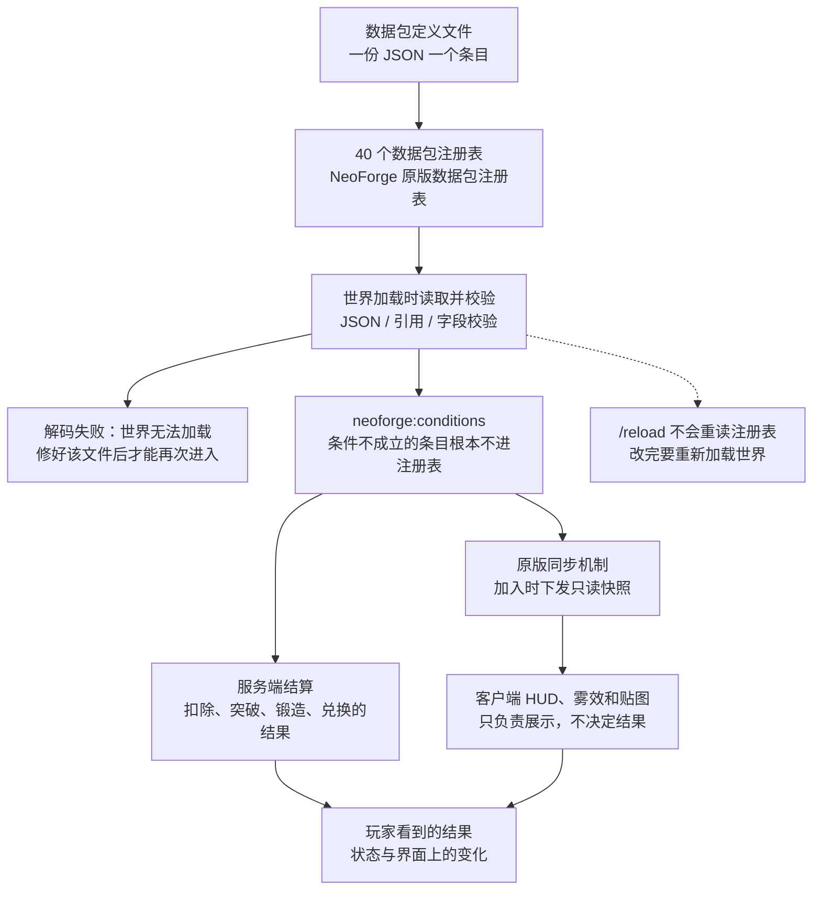

# 数据包开发总览

## 文件路径

```text
data/<namespace>/mxt/<registry>/<path>.json
```

例如 `data/example/mxt/ability/fireball.json` 的定义 ID 是 `example:fireball`。

**内容一多，请按类别把 JSON 分进子文件夹。** 一个注册表目录下平铺几十上百个文件时，「哪几个是同一套流派的被动」只能靠文件名猜；分好类之后路径本身就是索引：

```text
data/example/mxt/ability/sword/slash.json            → example:sword/slash
data/example/mxt/ability/sword/parry.json
data/example/mxt/ability/passive/body_tempering.json
data/example/mxt/artifact/sword/azure_flight_sword.json
data/example/mxt/artifact/charm/ward_jade_talisman.json
```

分类方式没有硬性规定，按用途（`passive/`、`active/`）、按流派（`sword/`、`alchemy/`）或按一次更新的批次都行。几条要注意：

- **目录就是 ID 的一部分**：`data/example/mxt/ability/sword/slash.json` 的 ID 是 `example:sword/slash`，**换目录等于换 ID**。别的定义、标签、存档（技能授予账本、冷却、轮盘格子的 id）存的全是这个 ID，所以分类要在写内容之前定好。
- 按 id 生成的 `name` / `description` 键也带这段路径（`<类别>.mxt.<命名空间>.<路径>`，路径里的 `/` 原样保留），分文件夹不会多出第二套翻译键规则。
- 标签有自己的一棵树（`tags/mxt/<注册表名>/...`），**不必**与定义目录逐层对应；按同一个分类习惯摆只是为了好找。标签里的值要写带目录的**完整 ID**。
- 层级只影响可读性，**不参与加载与校验**：`data/<命名空间>/mxt/` 下面第一层永远是注册表名（`ability/`、`artifact/`……），分类只能加在它下面；把所有文件塞进同一个注册表目录也照样能跑。

数据包加载使用 NeoForge 原生可写注册表，服务器加载后同步到客户端。定义读出来就是只读的，不要在运行时改动从定义里取到的集合。

共同的规则在[数据包约定](/datapack/conventions)：怎么写引用、标签怎么用、名字与描述从哪来、写错的字段会怎样、数值怎么写。

## 注册表索引

| 分类 | 注册表 |
| --- | --- |
| 资源与修炼 | `resource`、`aura`、`element`、`element_reaction`、`realm_stage`、`spirit_root`、`physique`、`technique`、`progression`、`cultivation` |
| 技能与规则 | `ability`、`curse`、`formation`、`tribulation`、`trigger`、`talisman` |
| 灵气与世界 | `aura_zone`、`secret_realm`、`block_aura` |
| 物品与品质 | `pill`、`pill_binding`、`technique_binding`、`artifact`、`quality`、`item_aura`、`currency`、`default_quality`、`item_binding`、`weapon_binding`、`tool_binding`、`blueprint_binding` |
| 炼丹与灵植 | `medicinal_property`、`spirit_herb`、`alchemy_furnace`、`alchemy_wall_material`、`heat_source` |
| 经济与内容 | `forging_method`、`forging_blueprint`、`creature_profile`、`contract_type` |

**七张物品键的注册表**（`item_aura`、`currency`、`default_quality`、`item_binding`、`weapon_binding`、`tool_binding`、`blueprint_binding`）里，`currency` 用 `item` 认领物品、其余六张用 `items`，**两张方块键的**（`block_aura`、`heat_source`）按 `blocks` 认领方块；文件、字段形状与加载规则与其余注册表完全一致，见 [JSON 数据格式](/datapack/json/index)。

丹方不是注册表：它是原版配方类型 `mxt:alchemy`，文件放在 `data/<命名空间>/recipe/` 下，字段见[炼丹配方](/datapack/json/alchemy_recipe)。

## 模块页面

- [resource：资源与资源条](/datapack/json/resource)
- [修炼、境界与灵根](/datapack/json/cultivation)
- [灵气环境与灵气物品](/datapack/json/aura)
- [Ability、Cost 与 Condition](/datapack/json/ability)
- [物品绑定、品质与经济](/datapack/json/item_binding)
- [阵法、锻造与炼丹](/datapack/json/formation)
- [其他注册表](/datapack/json/index)
- [数据包示例](/datapack/examples)

## 加载与覆盖

40 个数据包注册表使用 NeoForge 原版数据包注册表加载；**世界加载时**读取并校验，并在客户端加入时通过原版同步机制提供只读快照。从磁盘上的文件到玩家看到的结果就是下面这条路径。



- 文件冲突遵循 Minecraft 数据包优先级：高优先级数据包覆盖低优先级数据包的同一路径。
- 原版标签使用 `replace: false` 时，值按数据包合并顺序追加；除品质排序标签外，玩法不依赖标签值顺序。

名字与描述的翻译键、`neoforge:conditions`、写错字段会怎样，都在[数据包约定](/datapack/conventions)。

把这个规则展开成一句可操作的判断：**同一个 id 的新旧两份定义不会同时存在**，高优先级包的那一份整份取代低优先级包的那一份，不会合并字段。

## 加载、同步与调试

- 这些注册表属于原版数据包注册表，**在世界加载时读取**：JSON 解析、条目解析和字段校验都在世界加载过程中完成，`neoforge:conditions` 也在这一步判掉，条件不成立的条目连解码都不会进。`/reload` 不会重新读取它们——`/reload` 只刷新配方、战利品表、进度、函数这些原版监听器，以及 KubeJS 的服务端脚本。改完要重新加载世界（单机退回标题界面再进入，或重启服务器）。
- 动态注册表由原版同步机制在客户端加入时发送；客户端 HUD、雾效和贴图只负责展示，不决定扣除、突破、锻造或兑换结果。
- `/mxt aura query` 查询当前位置最终灵气；`/mxt aura vein` 查询灵石矿脉信息。
- `/mxt registries list` 列出这些动态注册表与各自的条目数量；`/mxt registries validate` 报出上一次构建发现的所有问题，并逐条指出问题来自哪个文件（修炼、技能与功法的引用链条，以及忘了写行为的触发器规则）——没有问题时报出注册表数量、条目总数与「校验通过」。世界加载完之后跑一次这条命令，可以确认数据包产出的注册表状态是能用的。
- `/mxt technique repair` 清理玩家数据里**已失效的功法引用**（引用的定义已被数据包删除、或被 `neoforge:conditions` 挡掉时使用）；`dry-run` 只报告不改动；`/mxt technique drop <id>` 精确移除某一门功法。见下节。
- `/picker [<分类 id>]` 打开物品选择器，直接查看这些定义认领的物品或方块：分类就是注册表 id（如 `/picker mxt:aura`、`/picker mxt:artifact`、`/picker mxt:currency`、`/picker mxt:item_binding`、`/picker mxt:block_aura`），不写则列出全部已注册分类。物品键的注册表列它认领的物品，`mxt:block_aura` 与 `mxt:heat_source` 列它们认领的方块。需要 gamemaster 权限，且只在创造模式下可用；顶层 `/picker` 别名由服务端配置「命令别名 → /picker」开关，`/mxt picker` 始终可用。
- 测试模组数据位于 `src/test-mod/resources/data/mxt_test/mxt`，启动测试服务端可验证数据包闭环。

### 修复失效的功法引用

玩家已学会的功法以**引用**形式存在玩家数据里。当数据包**删掉**某个 `technique`、或用 `neoforge:conditions` 把它挡在注册表之外后，存档里的引用就指向了一个不存在的定义。

**这种情况不会摧毁数据。** 玩家数据里的功法列表逐元素解码，**跳过解码失败的条目并保留其余条目**，同时打出一条 WARN 日志：

```
[WARN]: Ignoring invalid list element: Failed to get element <namespace>:<path>
```

也就是说，失效引用**只损失它自己**：其他功法、其他字段都正常加载。看到这条 WARN 就说明确实存在失效引用；**看不到就说明不存在**，此时问题在别处，不要用修复命令去「治」它。

| 命令 | 作用 |
| --- | --- |
| `/mxt technique repair dry-run` | 报告有多少条失效引用，**不改动任何数据** |
| `/mxt technique repair` | 清理失效引用与重复项，并重建其带来的属性、能力与等级 |
| `/mxt technique drop <id>` | 按 id 精确移除一门功法（包括仍然有效的） |

清理后会把失效功法曾提供的属性、能力和资源上限一并收回——否则玩家会保留一门已经不在身上的功法给的加成。

:::warning
修复命令只处理**引用失效**（指向已经不存在的定义）和**重复条目**。功法面板空白、功法书无反应若**没有**伴随 `Ignoring invalid list element` 警告，则不是本节的问题，需要另找原因。
:::

:::warning
定义解码是唯一的加载契约。本文中的默认值、字段范围和示例以当前源码为准；数据包写入未列出的字段不会自动生效，写入未知 `type` 会导致加载失败。
:::
