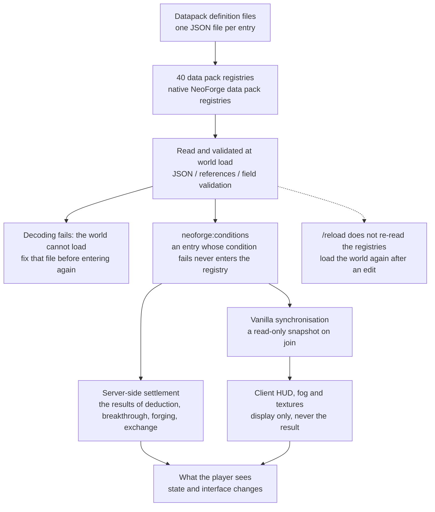

# Datapack Development Overview

## File Location

```text
data/<namespace>/mxt/<registry>/<path>.json
```

For example, the definition in `data/example/mxt/ability/fireball.json` has the ID `example:fireball`.

**Once there is a lot of content, sort the JSON into subdirectories by category.** With dozens or hundreds of files sitting flat in one registry directory, "which of these are the passives of the same school" can only be guessed from the filenames; once they are sorted, the path is the index:

```text
data/example/mxt/ability/sword/slash.json            → example:sword/slash
data/example/mxt/ability/sword/parry.json
data/example/mxt/ability/passive/body_tempering.json
data/example/mxt/artifact/sword/azure_flight_sword.json
data/example/mxt/artifact/charm/ward_jade_talisman.json
```

There is no hard rule for how to categorise: by purpose (`passive/`, `active/`), by school (`sword/`, `alchemy/`) or by the batch an update added are all fine. A few things to keep in mind:

- **The directories are part of the ID**: `data/example/mxt/ability/sword/slash.json` has the ID `example:sword/slash`, so **moving a file to another directory changes its ID**. Other definitions, tags and saved data (the ability grant ledger, cooldowns, the ids in wheel cells) all store that ID, so settle the categories before writing content.
- The `name` / `description` keys generated from the id carry that path too (`<category>.mxt.<namespace>.<path>`, with the `/` in the path kept as written), so folders do not introduce a second set of translation-key rules.
- Tags have a tree of their own (`tags/mxt/<registry>/...`) and do **not** have to mirror the definition directories level for level; keeping the same habit there only makes them easier to find. The values in a tag still have to be the **full ID including the directories**.
- The levels only affect readability and take **no part in loading or validation**: the first level under `data/<namespace>/mxt/` is always the registry name (`ability/`, `artifact/`, …), and categories can only go below it; cramming every file into one registry directory works just as well.

Data packs load through the native NeoForge writable registry, and the server syncs it to the client after loading. A definition decodes read-only: do not modify the collections you get out of one at runtime.

The rules shared by every definition are on [Datapack Conventions](/en/datapack/conventions): how to write a reference, how tags work, where names and descriptions come from, what happens to a field you got wrong, and how to write a number.

## Registry Index

| Category | Registries |
| --- | --- |
| Resources and cultivation | `resource`, `aura`, `element`, `element_reaction`, `realm_stage`, `spirit_root`, `physique`, `technique`, `progression`, `cultivation` |
| Abilities and rules | `ability`, `curse`, `formation`, `tribulation`, `trigger`, `talisman` |
| Aura and world | `aura_zone`, `secret_realm`, `block_aura` |
| Items and quality | `pill`, `pill_binding`, `technique_binding`, `artifact`, `quality`, `item_aura`, `currency`, `default_quality`, `item_binding`, `weapon_binding`, `tool_binding`, `blueprint_binding` |
| Alchemy and herbs | `medicinal_property`, `spirit_herb`, `alchemy_furnace`, `alchemy_wall_material`, `heat_source` |
| Economy and content | `forging_method`, `forging_blueprint`, `creature_profile`, `contract_type` |

**Seven item-keyed registries** (`item_aura`, `currency`, `default_quality`, `item_binding`, `weapon_binding`, `tool_binding`, `blueprint_binding`): all of them except `currency` claim items through `items` (`currency` uses `item`), and **two block-keyed ones** (`block_aura`, `heat_source`) claim blocks through `blocks`; their file layout, field shape and loading rules are exactly those of every other registry, see [JSON Data Formats](/en/datapack/json/index).

An alchemy recipe is not a registry: `mxt:alchemy` is a vanilla recipe type whose files live under `data/<namespace>/recipe/`, see [Alchemy Recipe](/en/datapack/json/alchemy_recipe).

## Module Pages

- [resource: Resources and Resource Bars](/en/datapack/json/resource)
- [Cultivation, Realms and Spirit Roots](/en/datapack/json/cultivation)
- [Aura Environment and Aura Items](/en/datapack/json/aura)
- [Ability, Cost and Condition](/en/datapack/json/ability)
- [Item Bindings, Quality and Economy](/en/datapack/json/item_binding)
- [Formations, Forging and Alchemy](/en/datapack/json/formation)
- [Other Registries](/en/datapack/json/index)
- [Datapack Examples](/en/datapack/examples)

## Loading and Overriding

The 40 data pack registries load through the native NeoForge data pack registry system; they are read and validated **while the world loads**, and a read-only snapshot is provided to the client on join through the vanilla synchronisation mechanism. From a file on disk to what the player sees is the path below.



- File conflicts follow Minecraft data pack priority: a higher priority data pack overrides the same path from a lower priority data pack.
- When a vanilla tag uses `replace: false`, values are appended in data pack merge order; apart from quality ordering tags, gameplay does not depend on tag value order.

Where a name and description come from, how `neoforge:conditions` works and what a mistyped field does are on [Datapack Conventions](/en/datapack/conventions).

One operational way to put the rule: **an old and a new definition of the same id never coexist**. The copy in the higher priority pack replaces the copy in the lower priority pack outright, without merging fields.

## Loading, Syncing and Debugging

- These registries are vanilla data pack registries and are **read while the world loads**: JSON parsing, entry resolution and field validation all happen during world load, and `neoforge:conditions` is decided at that point too, so an entry whose condition fails is not even decoded. `/reload` does not re-read them — it only refreshes vanilla reload listeners such as recipes, loot tables, advancements and functions, plus the KubeJS server scripts. An edit needs the world loaded again (in single player, leave to the title screen and enter again, or restart the server).
- The dynamic registries are sent by the vanilla synchronisation mechanism when the client joins; the client HUD, fog and textures only display, and never decide the result of deduction, breakthrough, forging or exchange.
- `/mxt aura query` queries the final aura at the current position; `/mxt aura vein` queries spirit stone vein information.
- `/mxt registries list` lists these dynamic registries and their entry counts; `/mxt registries validate` reports every problem the last build found, naming the file each one comes from (the reference chains of cultivation, abilities and techniques, and any trigger rule that forgot its action) — with no problems it reports the number of registries, the total entry count and that validation passed. Run it once after the world has loaded to confirm that the registry state the data pack produced is usable.
- `/mxt technique repair` cleans up **stale technique references** in player data (for when a referenced definition was deleted by the data pack or blocked by `neoforge:conditions`); `dry-run` only reports and changes nothing; `/mxt technique drop <id>` removes one technique precisely. See the next section.
- `/picker [<category id>]` opens the item picker to look straight at the items or blocks these definitions claim: a category is a registry id (`/picker mxt:aura`, `/picker mxt:artifact`, `/picker mxt:currency`, `/picker mxt:item_binding`, `/picker mxt:block_aura`), and with none written it lists every registered category. An item-keyed registry lists the items it claims, while `mxt:block_aura` and `mxt:heat_source` list the blocks they claim. The command comes from the bundled Picker mod; it needs gamemaster permission and only works in creative mode.
- The test mod data lives in `src/test-mod/resources/data/mxt_test/mxt`; start the test server to verify the whole data pack loop.

### Repairing Stale Technique References

A technique a player has learned lives in player data as a **reference**. After a data pack **deletes** a `technique`, or blocks it from the registry with `neoforge:conditions`, that saved reference points at a definition that no longer exists.

**This does not destroy data.** The technique list in player data decodes element by element, **skipping the entries that fail to decode and keeping the rest**, and logs one WARN line:

```
[WARN]: Ignoring invalid list element: Failed to get element <namespace>:<path>
```

In other words, **a stale reference only loses itself**: other techniques and other fields load normally. Seeing that WARN proves stale references do exist; **not seeing it means there are none**, so the problem is elsewhere and the repair command is not the way to "cure" it.

| Command | Effect |
| --- | --- |
| `/mxt technique repair dry-run` | Reports how many stale references there are and **changes no data at all** |
| `/mxt technique repair` | Cleans up stale references and duplicates, then rebuilds the attributes, abilities and levels they came with |
| `/mxt technique drop <id>` | Removes one technique by id, precisely (including one that is still valid) |

The cleanup also takes back the attributes, abilities and resource maxima that a stale technique used to grant — otherwise a player would keep the bonuses of a technique they no longer carry.

:::warning
The repair commands only handle **stale references** (pointing at a definition that no longer exists) and **duplicate entries**. A blank technique screen or a technique manual that does nothing is **not** this section's problem unless it comes with an `Ignoring invalid list element` warning, and needs to be tracked down elsewhere.
:::

:::warning
Definition decoding is the only loading contract. The defaults, field ranges and examples in this page follow the current source; a field a data pack writes that is not listed here does not come into effect by itself, and an unknown `type` fails the load.
:::
