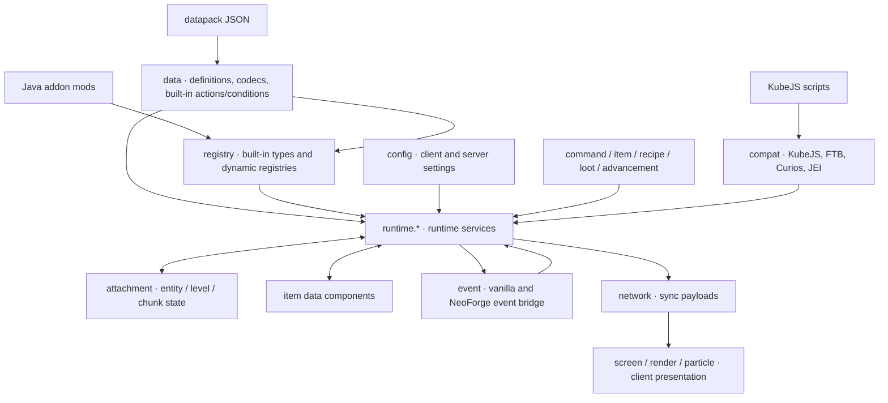
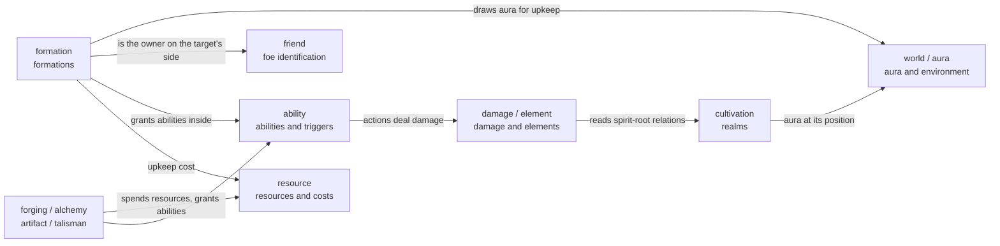

# Technical Details

This category holds **source-level explanations**: which classes make up a subsystem, how one call travels through them, why it is written the way it is, and where its boundaries and costs are.

It answers a different question from the other two categories:

| What you want to know | Where to look |
| --- | --- |
| What a JSON field means and how to write it | [Datapack](../datapack/overview.md) |
| Which class or service you can call | [Java API](../java/index.md) |
| **Why** it is built this way inside | Here |

## Articles

| Article | Contents |
| --- | --- |
| [Data Loading](./data-loading.md) | What one JSON file passes through on its way to a settlement: what the content and binding layers are, the four outcomes of decoding, where a world load and a `/reload` align the caches, where cross-entry validation reports, and why a component overrides a declaration. |
| [Data Components](./data-components.md) | All 33 item data components the mod registers, one by one: what each holds, who writes it, who reads it, and which ones take part in "which declaration applies" rather than only holding state. |
| [Attachments](./attachments.md) | All 30 attachments the mod registers, one by one: whether each hangs on an entity, a chunk or a level, the three sync tiers (saves, syncs, follows through death), how a dirty flag reaches the client, and how "one per module" is decided. |
| [Damage System](./damage.md) | The full path from a strike being dealt to a target losing health: why outgoing and incoming damage have to be settled in two different places, how element relations take part, which damage-dealing paths were folded into the pipeline, and the real order of operations behind a combat number. |
| [Foe Identification](./identification.md) | How "does this entity count as mine" is answered: where the lists live, how the relation event overrides them, who answers for an offline player, how team mods plug in, and which callers ask the question today. |
| [Aura Calculation](./aura.md) | How the aura value at a position is computed: how the static template is picked, how chunk stock and block emitters are merged, where the 140 µs of one query goes, how large the sub-chunk approximation error is (with two study charts), and why the client only ever sees a snapshot. |
| [Tick Task Dispatcher](./tick-dispatcher.md) | How due queues, random intervals, count budgets and their switch work, including callback changes, clock jumps, failure reports and block-cache integration boundaries. |
| [Ability Casting](./ability.md) | What one cast passes through and in what order, the difference between a wheel key and a direct cast, where an ability's state is kept and how content writes and reads it — the six kinds, cooldown and charges, and what clearing a grant does. |
| [Cost](./cost.md) | How one payment goes from "what must be paid" to the real deduction: why the amount is bound while pricing, why one store should only be written by one entry, why the ledger-and-shares design was deleted (it produced four kinds of defect that charge the wrong amount), and what the current shape still costs (no rollback, an opaque script, no shared slot plan). |
| [Talisman Scoring](./talisman-scoring.md) | How a traced drawing becomes a completion between 0 and 1: the scoring parameters, each of steps 0 to 7 with its formulas, why shape is an F1, why translation and scale are not judged while rotation is, the numbers the probe legs measured with two known deviations, and what server authority and point-by-point reconciliation do and do not stop. |

## Source Map

| Subsystem | Entry point | Main source |
| --- | --- | --- |
| Damage system | `DamageCalculationService` | `src/main/java/com/iafenvoy/mxt/runtime/damage/` |
| Foe identification | `FriendService` | `src/main/java/com/iafenvoy/mxt/runtime/friend/` |
| Aura calculation | `AuraService` | `src/main/java/com/iafenvoy/mxt/runtime/world/` |
| Tick task dispatcher | `TickDispatcher` | `src/main/java/com/iafenvoy/mxt/util/dispatcher/` |
| Cost | `CostPayment` | `src/main/java/com/iafenvoy/mxt/data/cost/` |

## Module Relationships

The code splits into four layers: **input** (datapacks, KubeJS, addon mods), **kernel** (definitions and registration), **runtime services** (the singletons that do the work), and **state and exits** (attachments, events, networking, the client). An arrow means "reads or drives", not a strict compile-time dependency - a built-in action is implemented in `data` and still calls into `runtime`.

The runtime services read each other as well, and the direction is mostly one way: environment and state are data, and the gameplay reads and changes it. These are a few of the relationships that really exist (not all of them):

## Conventions

- Class and method names are written as Java writes them, with the shared package prefix `com.iafenvoy.mxt` shortened and spelled out only on first use (so `runtime.damage.DamageCalculationService#deal` means the `deal` method of `com.iafenvoy.mxt.runtime.damage.DamageCalculationService`).
- Source paths are relative to the repository root.
- These pages describe the **current implementation**. It changes more freely than datapack fields or the public API: field names and interfaces are kept when compatibility is at stake, internal structure is not. So read these pages to understand the code and why a piece of logic is written the way it is — not as a compatibility promise across versions. That is what [Datapack](../datapack/overview.md) and [Java API](../java/index.md) are for.
- Each article tries to say "why not the other way" — that is the part that takes the longest to reconstruct from source and is the easiest to forget by the next change.
