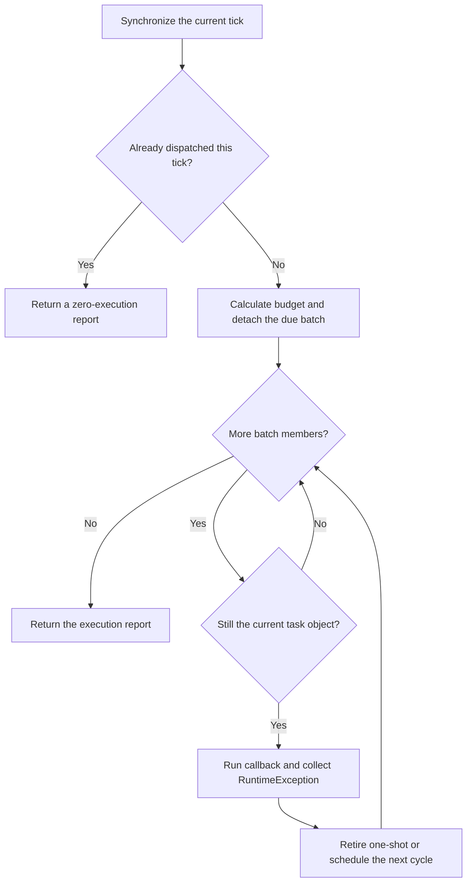

# Tick Task Dispatcher

The tick task dispatcher centralizes when work runs, how much is selected for one tick, and how cancellation removes it. A caller supplies a unique task key and a `Runnable`, then passes the current time from its own tick entry point.

Callbacks run synchronously on the calling thread. The dispatcher creates no threads, subscribes to no events and persists no state. Block aura caches use it for random section rescans, and stock regeneration uses it for staggered chunk tasks; the dispatcher itself depends on no world, chunk or aura rules.

## Three components

The source is under `src/main/java/com/iafenvoy/mxt/util/dispatcher/`, in the package `com.iafenvoy.mxt.util.dispatcher`.

| Type | Responsibility |
| --- | --- |
| `TickDispatcher<K>` | Task index, due queue, execution and reports |
| `TickInterval` | Fixed or inclusive random intervals |
| `TickExecutionLimit` | Fixed, adaptive or disabled count budgets |

Constructors take an initial tick, a random seed and an optional budget policy. Omitting the policy leaves the count unlimited. Every instance belongs to its creating thread, including queries; serializing access does not let another thread take ownership.

## Task identity and due index

Two indexes serve different purposes: a `HashMap` finds the current task by key, while a `TreeSet` orders waiting tasks by `(dueTick, sequence)`. Earlier deadlines run first. For equal deadlines, the task registered or rescheduled first runs first.

| Operation | Average or per-operation cost |
| --- | --- |
| Key lookup | Average O(1) |
| Registration, rescheduling or cancellation | O(log M) |
| Removing one task and scheduling its next cycle | O(log M) |
| A tick with no due tasks | O(1) |
| Holding M tasks | O(M) space |

Cancellation removes the ordered-set node immediately, without leaving stale entries for later removal. Processing B due tasks normally costs about O(B log M), plus the callbacks themselves; it does not scan all tasks that are not yet due.

Keys use `equals/hashCode`, cannot be null, and must keep both results stable while registered. Duplicate registration returns `false`, preserving the callback, deadline and interval without consuming randomness. Cancel first to register a replacement, or use a rescheduling method.

## Registration, rescheduling and time

| Call | Effect |
| --- | --- |
| `scheduleOnce(key, delayTicks, action)` | Register a one-shot task; zero delay is allowed |
| `schedule(key, interval, action)` | Register a recurring task; the first execution also waits for interval |
| `reschedule(key, delayTicks)` | Change the next deadline, preserving recurrence or one-shot status |
| `reschedule(key, interval)` | Replace the interval and draw again; also turns a one-shot into a recurring task |
| `cancel(key)` | Remove one task; an unknown key returns `false` |
| `clear()` | Remove all tasks, preserving the clock, budget and current tick's dispatch status |
| `advanceTo(now)` | Synchronize the clock without running tasks |
| `tick(now)` | Synchronize the clock, run this tick's due batch and return a report |

Both rescheduling methods return `false` for unknown keys rather than creating tasks. Relative delays start at `currentTick()`; the dispatcher does not read world time or system time itself.

If the last dispatch was at 100 and a chunk loads at 500, directly registering a fixed 600-tick interval gives a deadline of 700. Calling `advanceTo(500)` first makes it 1100. Even if other tasks are overdue, synchronization does not run them inside the load callback.

Consecutive calls with the same `now` dispatch only once, even when the first call has no work. A repeated `tick` reports zero executions and an empty failure list. Clearing, rescheduling, toggling limits or calling `advanceTo` with the same time cannot reset eligibility. Other report fields still reflect the queue at the time of the call.

## How one tick runs



The diagram covers normal returns and `RuntimeException`; `Error` handling is described below. The budget and batch are fixed before callbacks start, so changing the population or policy cannot expand the current batch.

Detached tasks remain in the key index until completion. Each callback is guarded by an **object identity** check. Callbacks may cancel, clear or reschedule themselves or other tasks; a replaced batch member cannot keep running. Cancelling and registering the same key cannot make the old batch invoke the new callback. Explicit self-cancellation or rescheduling overrides automatic recurrence.

Tasks created or rescheduled by a callback wait for the next different dispatch tick, even if already due or assigned zero delay. Disabling the count limit preserves this batch boundary, preventing an endless chain of newly created zero-delay tasks inside one call.

The count limit caps **entries selected into the batch**. If an earlier callback cancels later members, fewer callbacks may run than the budget allows; the dispatcher does not refill the batch from the queue.

## Fixed and random intervals

`TickInterval.fixed(n)` uses a fixed positive interval. `TickInterval.random(min, max)` draws from an inclusive range, requiring `0 < min <= max`. A random interval is drawn on registration, after each recurring execution, and when explicitly replacing the interval. It is not one random value reused forever.

| Situation | Next deadline |
| --- | --- |
| A fixed 600-tick task is registered at 100 | 700 |
| Due at 700, executed at 800, then draws 900 | 1700 |
| The clock jumps from 800 to 5000 | Each due task runs once, then starts its interval at 5000 |

Recurrence starts from **actual execution time**. Missed cycles are not replayed, and old deadlines are not chased in a burst. The interval is a target wait; insufficient budget can make the actual execution gap longer.

Each instance owns a `SplittableRandom`, without consuming the gameplay random stream. Equal seeds and equal operation order reproduce results. Adding or cancelling another task can change an individual task's future draws. Fixed intervals and rejected duplicate registrations consume no random draws.

## Count budgets and their switch

| Policy | Maximum entries selected this tick |
| --- | --- |
| `TickExecutionLimit.unlimited()` | All due tasks |
| `TickExecutionLimit.fixed(B)` | B, which must be positive |
| `TickExecutionLimit.adaptive(minimum, spreadTicks)` | `max(minimum, ceil(M / spreadTicks))` |

M is the **entire registered population** at the start of the tick, including tasks not yet due. Both `minimum` and `spreadTicks` must be positive. Population changes affect the next tick's calculation.

For `adaptive(8, 600)`, 24000 tasks allow 40 entries per tick, while 24001 allow 41. The budget scales without knowing how many chunks a world will ultimately load. The 600 is a budget spread parameter, not an additional recurrence interval or a deadline guarantee.

`setLimitEnabled(false)` temporarily removes the count cap; `true` restores the policy parameters. `setExecutionLimit(...)` replaces the policy. Default unlimited has no hidden smaller cap, so enabling it alone still imposes no practical count restriction; configure fixed or adaptive first. Zero is not a pause switch. A caller can pause by stopping clock dispatch.

**A count budget does not guarantee a millisecond limit.** An expensive callback occupies the calling thread synchronously and cannot be preempted. Random jitter reduces concentration but guarantees neither even distribution nor a fixed maximum delay. Disabling limits can run a large amount of due work in one call.

## Failures, reentrancy and clock boundaries

### Callback failures

A callback throwing `RuntimeException` counts as executed. Its exception and key enter `failures`, and other tasks continue. A one-shot retires, while a recurring task schedules its next cycle. Business effects already produced are not rolled back. The dispatcher logs nothing itself; the caller must handle the report. Ordinary business failures should be handled as results inside callbacks.

An `Error` propagates to the caller without returning a report. The current task still follows its completion rules. Detached but unexecuted batch members that remain valid are restored to the queue. Another call at the same tick does not restore dispatch eligibility.

### Reentrancy and threads

An instance cannot recursively call its own `tick` or change its clock with its own `advanceTo` from a callback; both calls are rejected. Independent instances may run nested on the same thread. A `ThreadLocal` guard is cleaned up in `finally`, so an exceptional exit does not permanently lock the instance.

Cross-thread access, negative times and negative delays are invalid calls and throw exceptions. Callers must supply non-null keys, callbacks and policies, without relying on runtime null checks. Thread ownership does not make the dispatcher a thread-safe container.

### Clock jumps and numeric limits

A forward jump runs each due task once. A backward jump preserves each task's remaining delay relative to the previous dispatch clock, while overdue work remains due. That path rebuilds the queue in O(M log M). Completed tasks do not return, and existing business effects are not reversed.

A backward jump starts a new dispatch phase. Once-per-tick eligibility applies to consecutive equal times, without retaining an unbounded history of every tick value. Callers must therefore use one time domain consistently, rather than alternating world time and a system counter.

Deadline addition saturates at `Long.MAX_VALUE` instead of wrapping negative and running early. A recurring task executed at that final time retires because no future deadline can be represented.

## Reports and backlog diagnostics

`tick` returns a `TickReport<K>`. Failure entries are `TaskFailure<K>`, carrying the original key and exception.

| Field or method | Meaning |
| --- | --- |
| `tick` | Current dispatch time |
| `executed` | Callbacks entered, including failed callbacks |
| `scheduled` | Entire registered population after the call |
| `nextDueTick` | Earliest queued deadline, empty when no tasks remain |
| `failures` | Unmodifiable list of this call's RuntimeException failures |
| `hasDueTasks()` | Whether due work remains after the call |
| `oldestOverdueTicks()` | Lateness of the earliest deadline, or zero when nothing is overdue |

Counts and deadlines are snapshots; later dispatches do not update an old report. Keys and exceptions remain their original objects. `scheduled` is not an exact due-backlog count: the core does not scan the queue for that diagnostic or measure callback duration itself.

`contains(key)`, `size()` and `nextExecution(key)` read the registration index. The no-argument `nextExecution()` only reads the waiting queue. During a callback, detached but incomplete batch members can still be found by key without appearing in that queue's earliest deadline. Prefer post-dispatch reports for diagnostics.

## Integration example

This wrapper owns a dispatcher and passes through business callbacks. Its `tick` returns the report to its caller. Construction, registration, ticking and cleanup must all run on the same owning thread.

```java
import com.iafenvoy.mxt.util.dispatcher.TickDispatcher;
import com.iafenvoy.mxt.util.dispatcher.TickExecutionLimit;
import com.iafenvoy.mxt.util.dispatcher.TickInterval;

final class RefreshLoop implements AutoCloseable {
    private final TickDispatcher<String> tasks;

    RefreshLoop(long now, long seed) {
        this.tasks = new TickDispatcher<>(now, seed,
                TickExecutionLimit.adaptive(8, 600));
    }

    boolean register(String key, long now, Runnable rebuild) {
        this.tasks.advanceTo(now);
        return this.tasks.schedule(key, TickInterval.random(600, 1199), rebuild);
    }

    boolean afterImmediateRebuild(String key, long now) {
        this.tasks.advanceTo(now);
        return this.tasks.reschedule(key, TickInterval.random(600, 1199));
    }

    TickDispatcher.TickReport<String> tick(long now) {
        return this.tasks.tick(now);
    }

    void forget(String key) {
        this.tasks.cancel(key);
    }

    @Override
    public void close() {
        this.tasks.clear();
    }
}
```

`afterImmediateRebuild` only resets the deadline. The caller must have completed the synchronous rebuild, and must not call this method from the dispatcher's own callback. Call `forget` on object unload and `close` when disposing the owner. Merely stopping ticks does not release keys or callbacks.

The block cache integration is in `AuraChunkTicker`: one queue per dimension, using `adaptive(8, 600)` and `random(600, 1199)`. Each chunk retains its own section-task list, with the actual chunk object and section Y in the key. Reloading the same coordinates does not give the new object work belonging to the old one.

Chunk loading still rebuilds the column synchronously, then registers all valid sections, including empty ones. Level Post advances the queue every tick after pending initialization. Rescans call the existing `BlockAuraService` rebuild entry point. Explicit administrative rebuilds reset deadlines; chunk unload cancels tasks, and level unload or server shutdown releases state. The owner logs failures as WARN with dimension, chunk and section Y.

Stock regeneration uses another dispatcher: one fixed-period task per chunk, with the first deadline assigned to a least-loaded phase and a per-tick budget of `max(1, ceil(registered chunks / period))`. Regeneration uses actual elapsed time. Period changes settle before rescheduling, clock rewinds reset anchors, and unload cancels tasks. Player coverage counts use position deltas independently, without a full periodic scan.

The dispatcher strongly references keys and callbacks. It does not determine whether an object is still valid or persist load generations and stock state. Unique identity, invalidation, failure handling and ownership remain caller responsibilities. See [Aura Calculation](./aura.md) for the full block-cache behavior.
