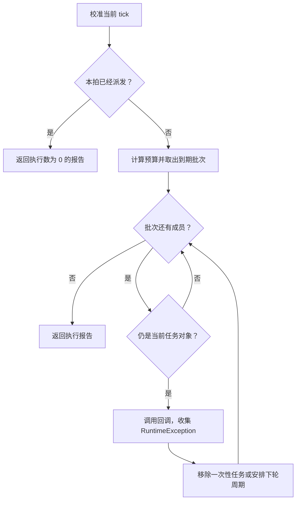

# Tick 任务调度器

Tick 任务调度器把“什么时候运行、这一拍取多少个、取消后怎样移除”收在同一处。业务提供唯一任务键和 `Runnable`，并在自己的 tick 入口传入当前时间。

它在调用线程同步执行回调，不创建线程、不自动订阅事件，也不负责持久化。方块灵气缓存用它做子区块随机巡检，库存再生用它按区块错峰执行；调度器本身不依赖世界、区块或灵气规则。

## 三个组成部分

源码位于 `src/main/java/com/iafenvoy/mxt/util/dispatcher/`，完整包名为 `com.iafenvoy.mxt.util.dispatcher`。

| 类型 | 职责 |
| --- | --- |
| `TickDispatcher<K>` | 任务索引、到期队列、执行与报告 |
| `TickInterval` | 固定或闭区间随机周期 |
| `TickExecutionLimit` | 固定、自适应或关闭的数量预算 |

构造器接收初始 tick、随机种子和可选的预算策略。省略策略时不限制数量。一个实例绑定创建线程，查询和修改都只能在该线程完成；不是“同一时刻只让一个线程进来”就可以转交给另一个线程。

## 任务身份与到期索引

内部保存两份互补的索引：`HashMap` 用任务键查找当前任务，`TreeSet` 按 `(dueTick, sequence)` 排列待执行任务。最早到期的先执行；同刻到期时，先登记或先重新安排的任务在前。

| 操作 | 平均或单次成本 |
| --- | --- |
| 按键查找 | 平均 O(1) |
| 登记、重排、取消 | O(log M) |
| 单项出队并安排下轮 | O(log M) |
| 没有到期任务的 tick | O(1) |
| 保存 M 个任务 | O(M) 空间 |

取消会直接删除有序集合中的节点，不保留等待以后出队的失效条目。一次处理 B 个到期任务的正常路径约为 O(B log M)，另加回调自身的成本；它不扫描全部未到期任务。

键按 `equals/hashCode` 判断，不能为 null，登记期间这两个结果必须保持稳定。重复登记返回 `false`，保留原回调、期限和周期，也不消耗随机数。重新登记前要先取消，或直接使用重排方法。

## 登记、重排与时间基准

| 调用 | 效果 |
| --- | --- |
| `scheduleOnce(key, delayTicks, action)` | 登记一次性任务，允许 0 延迟 |
| `schedule(key, interval, action)` | 登记周期任务，第一次也等待 interval |
| `reschedule(key, delayTicks)` | 改变下次期限，保留原有周期或一次性属性 |
| `reschedule(key, interval)` | 更换周期并重新抽样，也能把一次性任务变成周期任务 |
| `cancel(key)` | 主动移除一个任务，未知键返回 `false` |
| `clear()` | 移除全部任务，保留时钟、预算与本拍派发状态 |
| `advanceTo(now)` | 只校准时钟，不执行任务 |
| `tick(now)` | 校准时钟并执行本拍到期批次，返回报告 |

两个重排方法对未知键都返回 `false`，不会偷偷创建任务。相对延迟从 `currentTick()` 起算，不会自行读取世界时间或系统时间。

如果上一轮调度停在 100，而区块在 500 加载，直接登记固定 600 tick 的周期会得到 700 的期限。先调用 `advanceTo(500)` 再登记，期限才是 1100。校准时即使已有任务到期，也不会在装载回调中运行它们。

连续传入相同的 `now` 只派发一次，包括第一次没有任务可运行的情况。重复 `tick` 的报告执行数为 0，失败列表为空；清空任务、重排、切换预算或再次 `advanceTo` 到相同时刻都不能重置本拍资格。其他状态字段仍反映调用时的队列。

## 一拍如何执行



图中是正常返回及 `RuntimeException` 的路径；`Error` 的处理见下文。预算和批次在回调开始前确定，回调改变任务规模或策略不会扩大当前批次。

取出批次后，任务仍留在按键索引中。每次调用前检查**对象身份**，所以回调可以取消、清空、重排自己或其他任务；已被替换的旧任务不能继续执行。同键取消再登记，也不会让旧批次误运行新回调。显式自取消或自重排优先于自动周期安排。

回调新建或重排的任务，即使已经到期或延迟为 0，也要等下一个不同的调度 tick。关闭数量限制同样保留这个批次边界，避免回调不断生成零延迟任务，导致当前调用永远结束不了。

数量上限限制的是**选入批次的条目数**。若前面的回调取消了后面的成员，本拍实际调用数可以少于预算，不会从队列继续补满。

## 固定与随机周期

`TickInterval.fixed(n)` 使用固定正间隔；`TickInterval.random(min, max)` 在两端包含的范围内抽样，要求 `0 < min <= max`。随机周期在首次登记、每次周期执行结束、显式更换周期时分别抽样，不是登记时随机一次后一直重复那个值。

| 情况 | 下次期限 |
| --- | --- |
| 100 时登记固定 600 tick 周期 | 700 |
| 700 到期，800 才执行，下一轮抽到 900 | 1700 |
| 当前时间从 800 跳到 5000 | 到期任务各执行一轮，再从 5000 计时 |

周期从**实际执行时刻**重新安排，不补跑错过的周期，也不按原 deadline 连续追赶。随机范围是目标等待时间；预算不足时，实际执行间隔可以更长。

每个实例使用独立的 `SplittableRandom`，不会消耗玩法共享随机数。相同 seed 和相同操作顺序可复现结果；取消或增加其他任务后，不保证某个任务仍保留原来的随机序列。固定周期和被拒绝的重复登记不消耗随机抽样。

## 数量预算与开关

| 策略 | 本拍最多选入的条目数 |
| --- | --- |
| `TickExecutionLimit.unlimited()` | 全部到期任务 |
| `TickExecutionLimit.fixed(B)` | B，必须为正 |
| `TickExecutionLimit.adaptive(minimum, spreadTicks)` | `max(minimum, ceil(M / spreadTicks))` |

M 是本拍开始时**全部登记任务数**，包含尚未到期的任务；`minimum` 和 `spreadTicks` 都必须为正。任务增减在下一拍重新参与预算计算。

例如 `adaptive(8, 600)` 下，24000 个任务对应 40 个/拍，24001 个对应 41 个/拍。它随规模变化，不需要预先知道世界最终加载多少区块；600 表示预算的分摊参数，不是额外施加的周期或期限保证。

`setLimitEnabled(false)` 暂时关闭数量限制，`true` 恢复原策略参数；`setExecutionLimit(...)` 可以更换策略。默认 unlimited 没有藏一组较小上限，直接把它开启仍相当于没有实际数量约束；需要先设置 fixed 或 adaptive。0 不是暂停开关，业务暂停时可以停止推进调度器。

**数量预算不保证毫秒上限。** 一个昂贵回调会同步占用整个调用线程，调度器不会中途抢占。随机抖动减轻集中到期，但不保证均匀分布、无积压或固定最长延迟；关闭上限时也可能一次运行大量到期工作。

## 异常、重入与时钟边界

### 回调失败

回调抛出 `RuntimeException` 时，本次计入执行数，异常和任务键进入 `failures`，其他任务继续。一次性任务结束，周期任务仍安排下轮；已经产生的业务效果不会回滚。调度器不自行打印日志，调用者必须处理报告。普通业务失败应在回调内按结果处理，不使用异常表达。

`Error` 向调用者传播，不返回本次报告。当前任务仍按完成规则移除或安排下一轮；已经取出但尚未执行、仍有效的批次成员恢复到队列。同拍再次调用也不能重新获得执行资格。

### 重入与线程

同一实例不能在自己的回调里递归 `tick`，也不能调用自己的 `advanceTo` 改变时钟；这两种调用会被拒绝。独立实例可以在同一线程嵌套执行。重入守卫使用 `ThreadLocal` 与 `finally` 清理，失败退出不会把实例永久锁住。

跨线程访问、负时间、负延迟等属于错误调用，会抛出异常。调用者必须为键、回调与策略等必要参数提供非 null 对象，不应依赖运行时空值检查。线程绑定不会把调度器变成线程安全容器。

### 时间跳变与极值

向前跳跃只运行一轮到期任务。向后跳跃时，保留每项任务相对于原调度时刻的剩余等待时间，已到期任务仍到期；这条路径需要 O(M log M) 重建队列。完成的任务不会复活，已有业务效果不会撤销。

倒退时间会开启新的调度阶段，“一拍一次”只约束连续相同时间的调用，不维护全部历史 tick 的去重表。因此业务必须始终传入同一时间域，不能交替使用游戏时间和系统计数器。

期限相加溢出时饱和到 `Long.MAX_VALUE`，不会变成负数提前运行。在这个最终时刻执行的周期任务随后退出，因为没有可表示的未来期限。

## 报告与积压诊断

`tick` 返回 `TickReport<K>`，其中失败条目是 `TaskFailure<K>`，包含原任务键和异常。

| 字段或方法 | 含义 |
| --- | --- |
| `tick` | 当前调度时间 |
| `executed` | 实际进入回调的次数，包含失败回调 |
| `scheduled` | 调用结束后全部登记任务数 |
| `nextDueTick` | 队列最早期限，无任务时为空 |
| `failures` | 本次 RuntimeException 的不可修改列表 |
| `hasDueTasks()` | 调用结束后是否还存在到期任务 |
| `oldestOverdueTicks()` | 最早期限的逾期 tick 数，无逾期时为 0 |

报告的计数与期限是返回时的快照，后续派发不会回写它；任务键与异常对象仍是原引用。`scheduled` 不是精确的到期积压数，核心没有为了这个诊断值遍历全队列，也不自行测量耗时。

`contains(key)`、`size()`、`nextExecution(key)` 读取登记索引；无参数 `nextExecution()` 只查看待执行队列。在回调内部，已取出但尚未完成的批次成员仍可能被按键找到，却不出现在队列最早期限中。统计优先读取派发结束后的报告。

## 业务接入示例

下面的包装只持有调度器并转交业务回调；`tick` 把报告交回外层处理。构造、装载、tick 和清理都应在同一个持有线程上运行。

```java
import com.iafenvoy.mxt.util.dispatcher.TickDispatcher;
import com.iafenvoy.mxt.util.dispatcher.TickExecutionLimit;
import com.iafenvoy.mxt.util.dispatcher.TickInterval;

final class RefreshLoop implements AutoCloseable {
    private final TickDispatcher<String> tasks;

    RefreshLoop(long now, long seed) {
        this.tasks = new TickDispatcher<>(now, seed,
                TickExecutionLimit.adaptive(8, 600));
    }

    boolean register(String key, long now, Runnable rebuild) {
        this.tasks.advanceTo(now);
        return this.tasks.schedule(key, TickInterval.random(600, 1199), rebuild);
    }

    boolean afterImmediateRebuild(String key, long now) {
        this.tasks.advanceTo(now);
        return this.tasks.reschedule(key, TickInterval.random(600, 1199));
    }

    TickDispatcher.TickReport<String> tick(long now) {
        return this.tasks.tick(now);
    }

    void forget(String key) {
        this.tasks.cancel(key);
    }

    @Override
    public void close() {
        this.tasks.clear();
    }
}
```

`afterImmediateRebuild` 只重排期限，要求业务已经完成同步重建，并且不能在本调度器的回调里调用。对象卸载时调用 `forget`，持有状态关闭时调用 `close`；停止调用 tick 本身不会释放键和回调。

真实方块缓存接入在 `AuraChunkTicker`：每个维度一份队列，采用 `adaptive(8, 600)` 和 `random(600, 1199)`。区块持有自己的段任务列表，任务键带真实区块对象与 section Y；同坐标重载的新对象不会接收旧对象的工作。

区块加载仍同步重建整列缓存，再为全部有效段登记周期，包含当前空段。level Post 在 pending 初始化后每 tick 推进队列；巡检回调使用原有 `BlockAuraService` 重建入口。管理命令即时重建后重置期限，卸载主动取消，维度卸载与停服释放状态。失败报告由业务输出带维度、区块和 section Y 的 WARN。

库存再生复用另一个调度器：一个区块一个固定周期任务，首次期限按负载最少的相位分配，每 tick 预算为 `max(1, ceil(登记区块数 / 周期))`。再生按实际经过时间计量；周期变更先结算再重排，时间倒退重置锚点，卸载主动取消。玩家覆盖计数独立按位置差量维护，不经过全量周期扫描。

调度器强引用任务键与回调，不会替业务判断对象是否还有效，也不保存装载代次或库存状态。业务负责唯一身份、失效清理、失败处理与持有关系；更完整的方块缓存行为见[灵气计算](./aura.md)。
